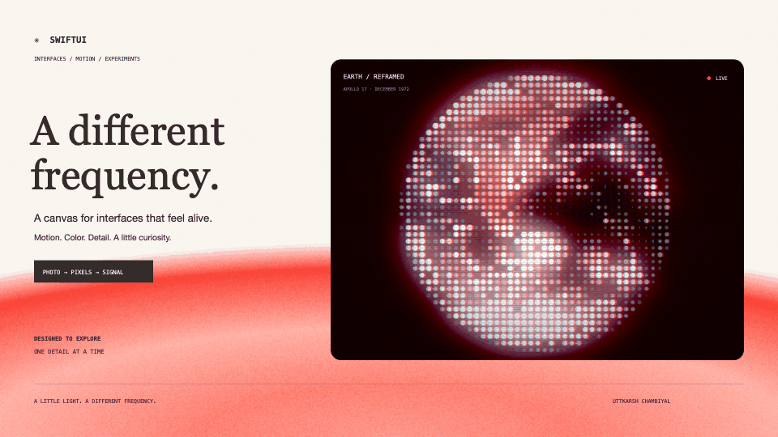
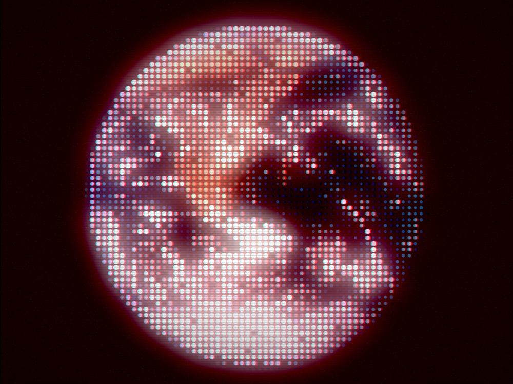
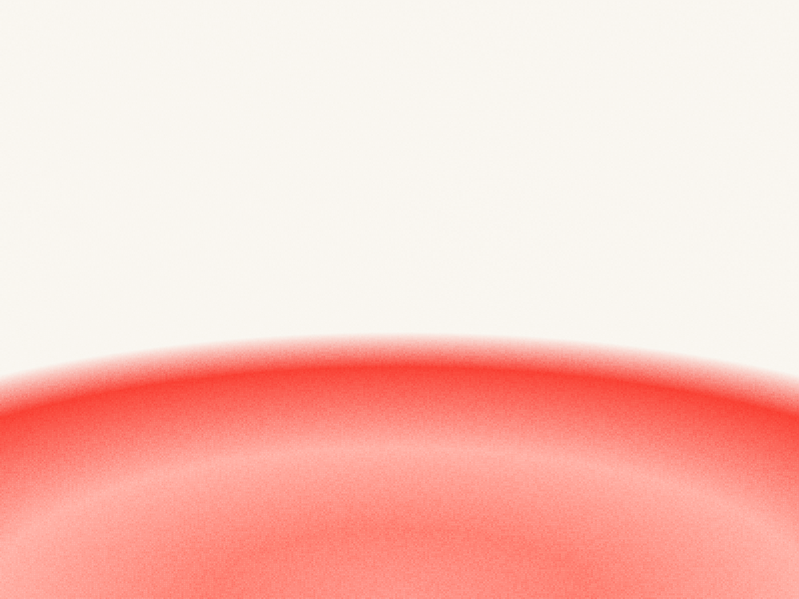
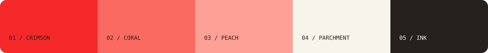

 

**LIGHT IN MOTION. IDEAS IN SWIFTUI.**

A personal canvas for expressive interfaces, thoughtful motion, and small details that make a screen feel alive.

 

 

[The visual DNA](#the-visual-dna) &nbsp; / &nbsp; [The palette](#the-palette) &nbsp; / &nbsp; [The direction](#the-direction)

 

## A different frequency.

Quiet surfaces. Electric details. A little curiosity.

**SwiftUI** is a home for future interface experiments: playful interactions, expressive components, and motion with a sense of purpose. This first edition establishes the visual identity — a warm paper canvas meeting a field of digital light.

 

## The visual DNA

<table>
<tr>
<td width="50%">

  
<strong>01 / THE SIGNAL</strong>
  
A familiar world, seen differently. Sampled light becomes a constellation of LED dots, with flicker, bloom, scan lines, and a crimson afterglow.
  
</td>
<td width="50%">

  
<strong>02 / THE HORIZON</strong>
  
A slow breath of color. Crimson fans into coral and peach, rising from a parchment surface with soft backlighting and a fine grain.
  
</td>
</tr>
</table>

The animated cover combines both studies. These are bundled image assets, so the effect plays directly on GitHub without scripts or external embeds. The stills above offer a motion-free look at each treatment.

 

## The palette

| Color | Hex | Character |
| :--- | :--- | :--- |
| Crimson | `#F52929` | The spark |
| Coral red | `#FB6A60` | The warmth |
| Peach pink | `#FDA096` | The softness |
| Parchment | `#F7F4EC` | Room to breathe |
| Ink | `#26211E` | A grounded contrast |

 

## The direction

**Make the ordinary feel considered.**

- **Interfaces** — clear hierarchy, generous space, and expressive details.
- **Motion** — fluid transitions that guide the eye.
- **Experiments** — small SwiftUI ideas with room to grow.

*Current stage: README and visual identity. A runnable SwiftUI application is not included in this edition.*

 

## Inspiration & credits

Visual treatments re-created from the supplied recipes for **HANZO Network LED Dots** and **Horizon Glow**, inspired by [21st.dev ASCII](https://21st.dev/community/ascii) and [21st.dev Gradients](https://21st.dev/community/gradients).

Earth photography: **NASA / Apollo 17 crew**, December 7, 1972 — [The Blue Marble](https://images.nasa.gov/details/as17-148-22727). The sample image is a NASA photograph; no affiliation or endorsement is implied.

 

**✳**

**A LITTLE LIGHT. A DIFFERENT FREQUENCY.**

Created by [Uttkarsh Chambiyal](https://github.com/Uttkarshchambiyal)

